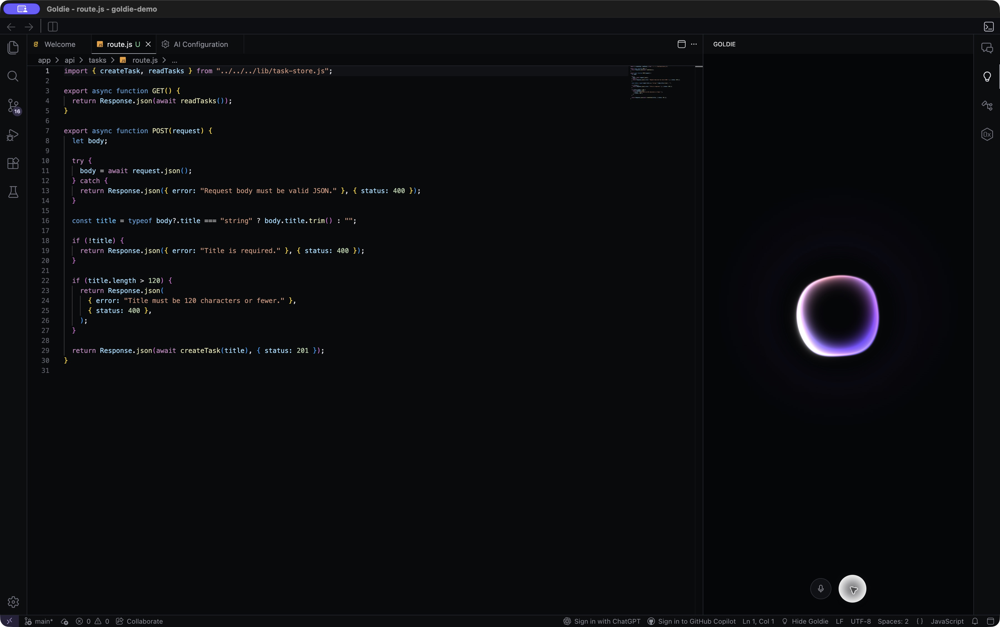
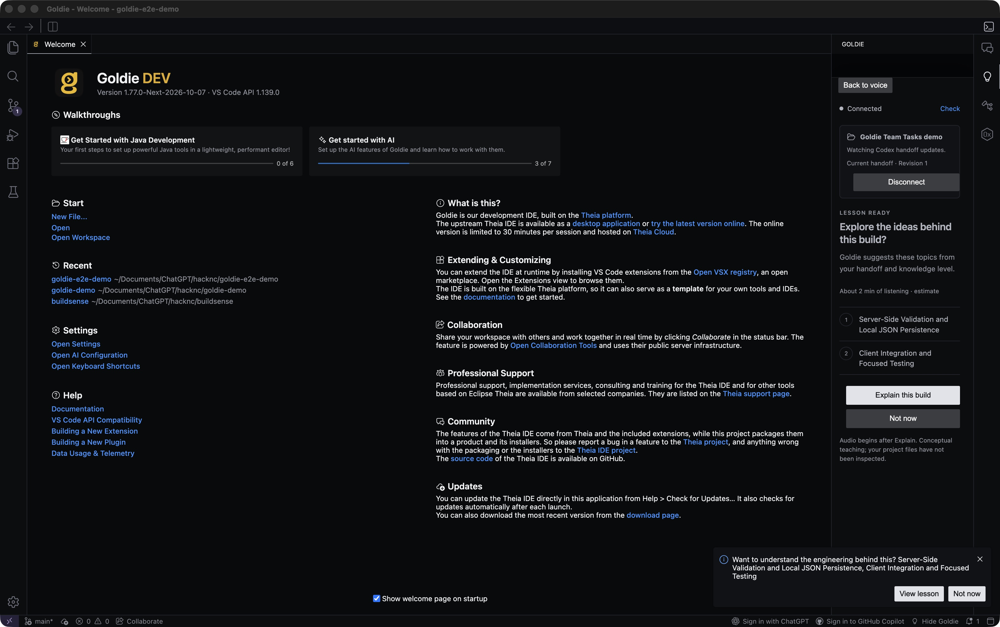
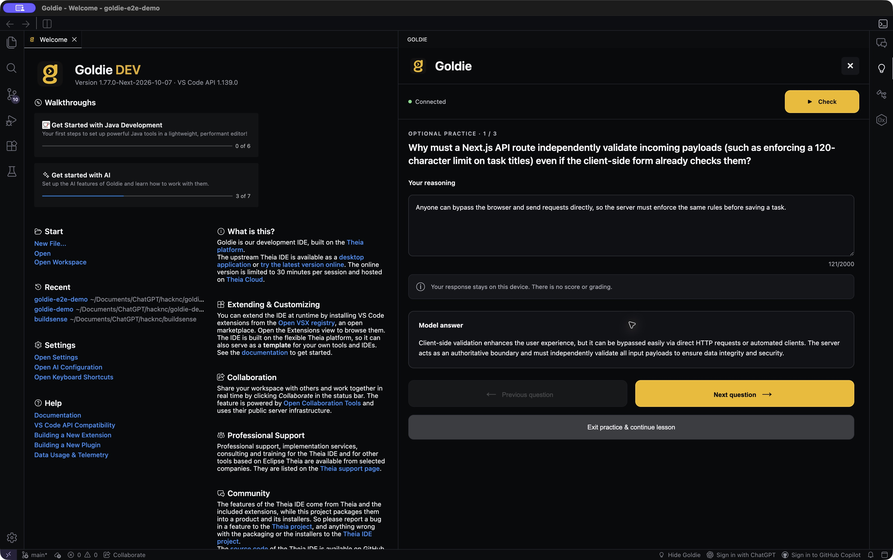

<div align="center">


# Goldie

**Build fast. Understand what you build.**

An AI-native IDE with a voice mentor that teaches you the engineering behind your app while your coding agent keeps building.

[**Try the demo**](https://goldie-judge-demo.vercel.app/) &nbsp; | &nbsp; [How Goldie works](#how-goldie-works) &nbsp; | &nbsp; [Run locally](#run-locally)

Built at [HackNC 2026](https://hacknc-2026.devpost.com/) by Rishit and Akshar.

</div>



## Why Goldie?

AI can build an app faster than you can understand it. Learning what happened usually means leaving your project to read documentation or watch tutorials.

Goldie brings that learning into your IDE. It uses your agent's engineering plan and your experience level to explain the concepts behind the build. It's for students, first-time builders, and developers learning a new stack with AI.

## Try the demo

**[Open Goldie in your browser →](https://goldie-judge-demo.vercel.app/)**

No download or account needed. Click **Begin sample build**, then follow the prompts to start a lesson, ask a question, and try optional practice.

The website replays a sample coding task. Live teaching needs the demo backend online; if it says **Backend unavailable**, the coding replay still works. To run Codex on your own project, use the desktop setup below.

## How Goldie works

1. **Build.** Ask Codex for a feature. It writes code and keeps a handoff of its plan and decisions.
2. **Choose to learn.** Goldie offers a learning path based on that handoff. Audio starts only when you accept.
3. **Listen.** Hear explanations suited to your level. Pause, replay, or skip a section.
4. **Ask.** Record and send a question, hear the answer, then return to your original lesson position.
5. **Practice.** Write your reasoning and compare it with a model answer. Practice is optional and has no score.

For a login feature, that might mean understanding the difference between being signed in and having permission to access someone else's data. The lesson follows what you're building while your agent continues working.

<details>
<summary>More screenshots: learning path and practice</summary>

**Learning path.** Goldie offers relevant topics before starting any audio.



**Optional practice.** Explain the idea in your own words, then reveal the model answer.



</details>

## The technology

| Technology | Role in Goldie |
| --- | --- |
| Eclipse Theia + Electron | Desktop IDE, editor, and mentor panel. |
| Codex | Builds your app and writes `.goldie/HANDOFF.md` with engineering context. |
| Gemini API | Plans lessons for your level, explains concepts, answers questions, and generates practice. |
| ElevenLabs API | Speaks generated lessons and answers. |
| whisper.cpp | Transcribes microphone questions locally. |

Our custom work connects the coding agent to the mentor: handoff tracking, the voice interface and reactive orb, lesson playback, question-and-return behavior, practice, and the teaching backend.

<details>
<summary>Engineering details and verification</summary>

- **Stable lessons:** an accepted lesson keeps its original handoff revision even as Codex updates the project. [Lesson backend](backend/src/lessons.ts)
- **Reliable return:** lesson and answer audio are separate, so asking a question preserves the lesson's clip and position. Cancelled requests cannot replace the active conversation. [Lesson controller](theia-extensions/product/src/browser/goldie/goldie-lesson-controller.ts)
- **Bounded context:** the handoff reader limits input size, checks file identity, rejects symlink substitution, and checks for credential patterns. [Handoff reader](theia-extensions/product/src/node/goldie-workspace-handoff.ts)

The [recorded desktop verification](docs/stage4-proof/E2E_REPORT.md) documents native Codex builds, automatic learning offers, real Gemini/ElevenLabs output, human voice questions, lesson return, and practice. It records 308 passing checks, lint, and an Electron build, alongside an initial recognition failure and remaining rehearsal checks.

Provider keys stay in the backend. Handoff context and question text go to Gemini; speech text goes to ElevenLabs. Microphone recordings are transcribed locally and are not retained.

Developer references: [setup](DEV_SETUP.md) · [product requirements](docs/Goldie_HackNC_PRD.md) · [desktop walkthrough](docs/JUDGE_DEMO.md) · [voice contracts](docs/stage3-integration.md).

```sh
yarn test:stage4
yarn lint
yarn electron build
```

These are local checks. Real-provider smoke commands use provider credits.

</details>

## Current status

Goldie is a hackathon prototype. The desktop supports live coding and voice teaching; the website uses a prepared coding replay. Questions use click-to-record and click-to-send. Answers explain concepts using the handoff, rather than citing your source files.

Next: answers grounded in actual code, spoken interruption, and user testing to measure whether Goldie helps builders explain and debug their projects. Final live browser rehearsal and desktop recording checks remain open in the verification notes.

## Run locally

Use **Node 24.21.0** and **Yarn Classic 1.22.22**. You'll need a configured Codex account, Gemini and ElevenLabs API keys, and local transcription tools for spoken questions. Provider usage may incur charges. See [development setup](DEV_SETUP.md) for native build prerequisites.

<details>
<summary>Show installation steps</summary>

### 1. Get the code and build

```sh
git clone https://github.com/aksharkakkad-web/goldie.git
cd goldie
nvm install
nvm use
npm install --global yarn@1.22.22
yarn --frozen-lockfile
yarn build:dev
yarn download:plugins
```

### 2. Configure the teaching backend

Create `backend/.env` from `backend/.env.example` if it does not already exist. Add `GEMINI_API_KEY` and `ELEVENLABS_API_KEY` there. Keep this file private.

For spoken questions, follow the [local transcription setup](docs/stage3-integration.md#local-transcription-setup-explicit-no-runtime-install) to configure whisper.cpp, its English model, and FFmpeg. Those tools are required in addition to the provider keys.

### 3. Start the backend and IDE

Run each block in a separate terminal from the repository root.

```sh
# Terminal 1: teaching backend
yarn backend:build
yarn backend:start
```

```sh
# Terminal 2: rebuild desktop changes
yarn electron watch
```

```sh
# Terminal 3: launch the desktop
yarn electron start .
```

Open your project in Goldie and configure Codex in the IDE's AI settings. Open **Goldie: Setup and lesson details** in the command palette, choose your level, and click **Connect this project**. Ask Codex for a feature. When it writes the engineering handoff, Goldie can offer a lesson.

For a repeatable walkthrough, use the included [Team Tasks example](examples/goldie-team-tasks/README.md). See [development setup](DEV_SETUP.md) for reload instructions and troubleshooting.

</details>

## Team and credits

- **Rishit:** IDE integration, voice interface, and project-context flow.
- **Akshar:** teaching backend and provider integrations.

### AI Usage Disclosure

We used AI-assisted coding tools, including Codex, to help develop and debug Goldie. We also used the Gemini API for personalized engineering explanations and ElevenLabs for voice interaction.

Our team designed the product experience, engineering context handoff, learning workflow, and system integrations, with AI assistance during implementation.

Goldie builds on [Eclipse Theia](https://github.com/eclipse-theia/theia) and [Theia IDE](https://github.com/eclipse-theia/theia-ide), with Codex, Gemini, ElevenLabs, and whisper.cpp. See [LICENSE](LICENSE) and [NOTICE.md](NOTICE.md).

<details>
<summary>Original Eclipse Theia IDE README</summary>

<br/>
<div id="theia-logo" align="center">
    <br />
    
    <h3>Eclipse Theia IDE</h3>
</div>

<div id="badges" align="center">

The Eclipse Theia IDE is built with this project.\
Eclipse Theia IDE also serves as a template for building desktop-based products based on the Eclipse Theia platform.

</div>

[](https://theia-ide.org/#theiaidedownload)
[](https://github.com/eclipse-theia/theia-ide/actions/workflows/build.yml?query=event%3Aschedule)
[](https://github.com/eclipse-theia/theia-ide/actions/workflows/build-next-release.yml)

[Main Theia Repository](https://github.com/eclipse-theia/theia)

[Visit the Theia website](http://www.theia-ide.org) for more documentation: [Using the Theia IDE](https://theia-ide.org/docs/user_getting_started/), [Packaging Theia as a Desktop Product](https://theia-ide.org/docs/blueprint_documentation/).

## License

- [MIT](LICENSE)

## Trademark

"Theia" is a trademark of the Eclipse Foundation
<https://www.eclipse.org/theia>

## What is this?

The Eclipse Theia IDE is a modern and open IDE for cloud and desktop. The Theia IDE is based on the [Theia platform](https://theia-ide.org).
The Theia IDE is available as a [downloadable desktop application](https://theia-ide.org/#theiaidedownload). You can also try the latest version of the Theia IDE online. The online test version is limited to 30 minutes per session and hosted via Theia.cloud. Finally, we provide an [experimental Docker image](#docker) for hosting the Theia IDE online.

The Eclipse Theia IDE also serves as a **template** for building desktop-based products based on the Eclipse Theia platform, as well as to showcase Eclipse Theia capabilities. It is made up of a subset of existing Eclipse Theia features and extensions. [Documentation is available](https://theia-ide.org/docs/composing_applications/) to help you customize and build your own Eclipse Theia-based product.

## Theia IDE vs Theia Blueprint

The Theia IDE has been rebranded from its original name “Theia Blueprint”. You can therefore assume the terms “Theia IDE” and “Theia Blueprint” to be synonymous.

## Development

### Requirements

Please check Theia's [prerequisites](https://github.com/eclipse-theia/theia/blob/master/doc/Developing.md#prerequisites), and keep node versions aligned between Theia IDE and that of the referenced Theia version.

### Documentation

Documentation on how to package Theia as a Desktop Product may be found [here](https://theia-ide.org/docs/blueprint_documentation/).

For adopters building their own products based on this template, see the [Adopter Guide](ADOPTER.md) for additional considerations.

### Repository Structure

- Root level configures mono-repo build with lerna
- `applications` groups the different app targets
  - `browser` contains a browser based version of Eclipse Theia IDE that may be packaged as a Docker image
  - `electron` contains the electron app to package, packaging configuration, and E2E tests for the electron target.
- `theia-extensions` groups the various custom theia extensions for the Eclipse Theia IDE
  - `product` contains a Theia extension contributing the product branding (about dialogue and welcome page).
  - `updater` contains a Theia extension contributing the update mechanism and corresponding UI elements (based on the electron updater).
  - `launcher` contains a Theia extension contributing, for AppImage applications, the option to create a script that allows starting the Eclipse Theia IDE from the command line by calling the 'theia' command.
- `patches` contains patches applied to upstream packages

### Build

For development and casual testing of the Eclipse Theia IDE, one can build it in "dev" mode. This permits building the IDE on systems with less resources, like a Raspberry Pi 4B with 4GB of RAM.

NOTE: If manually building after updating dependencies or pulling to a newer commit, run `git clean -xfd` to help avoid runtime conflicts.

```sh
# Build "dev" version of the app. It's quicker, uses less resources,
# but the front end app is not "minified"
yarn && yarn build:dev && yarn download:plugins
```

Production applications:

```sh
# Build production version of the Eclipse Theia IDE app
yarn && yarn build && yarn download:plugins
```

### Package the Applications

Currently we only produce packages for the Electron application.

_If you are trying to compile for ARM on an ARM machine, you may want to follow [these steps](https://github.com/eclipse-theia/theia-ide/issues/690#issuecomment-4157768849) beforehand._

```sh
yarn package:applications
# or
yarn electron package
```

The packaged application is located in `applications/electron/dist`.

### Create a Preview Electron Application (without packaging it)

```sh
yarn electron package:preview
```

The packaged application is located in `applications/electron/dist`.

### Running E2E Tests on Electron

The E2E tests are basic UI tests of the actual application, run against the preview of the packaged application.

```sh
yarn electron package:preview
yarn electron test
```

### Running Browser app

The browser app may be started with

```sh
yarn browser start
```

Then connect to <http://localhost:3000/>.

### Developing with Local Theia Framework

To build and test the Theia IDE against a local development version of the Theia framework, see [docs/developing-with-local-theia.md](docs/developing-with-local-theia.md).

### Troubleshooting

- [_"Don't expect that you can build app for all platforms on one platform."_](https://www.electron.build/multi-platform-build)

### Reporting Feature Requests and Bugs

The features in the Eclipse Theia IDE are based on Theia and the included extensions/plugins. For bugs in Theia please consider opening an issue in the [Theia project on Github](https://github.com/eclipse-theia/theia/issues/new/choose).
The Eclipse Theia IDE only packages existing functionality into a product and installers for the product. If you believe there is a mistake in packaging, something needs to be added to the packaging or the installers do not work properly, please [open an issue on Github](https://github.com/eclipse-theia/theia-ide/issues/new/choose) to let us know.

### Linux (AppImage)

The AppImage distribution of the Theia IDE requires FUSE (`libfuse2`) to be installed on the system. This is a general requirement of the AppImage format, not specific to Theia IDE. See the [AppImage documentation](https://docs.appimage.org/user-guide/troubleshooting/fuse.html) for details and installation instructions per distribution.

### Docker

The Docker image of the Theia IDE is currently in _experimental state_. It is built from the same sources and packages as the desktop version, but it is not part of the [preview test](https://github.com/eclipse-theia/theia-ide/blob/master/PUBLISHING.md#preview-testing-and-release-process-for-the-theia-ide).
You can find a prebuilt Docker image of the IDE [here](https://github.com/eclipse-theia/theia-ide/pkgs/container/theia-ide%2Ftheia-ide).

You can also create the Docker image for the Eclipse Theia IDE based on the browser app with the following build command:

```sh
docker build -t theia-ide -f browser.Dockerfile .
```

You may then run this with

```sh
docker run -p=3000:3000 --rm theia-ide
```

Then connect to <http://localhost:3000/>.

</details>
