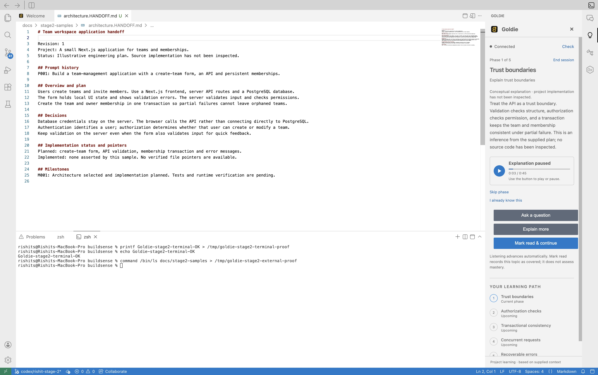

# Rishit's Stage 2 IDE milestone

**Historical IDE-only evidence.** Both tracks are now combined locally; use
[the authoritative integrated contract](stage2-api.md) and
[current verification](stage2-alignment-verification.md). The older 25-second
deadline and rejection recovery described below have been superseded by 30-second
offer/teach, 15-second acceptance and automatic idle recovery after definitive
rejections. Screenshots below remain controlled teaching/test-tone evidence only.

Verified locally on October 10, 2026, based on `main` commit `5a1a42b`.
This milestone covers Rishit's IDE changes and verification. Backend implementation
and live-service sign-off are separate.

## Completion boundary

Rishit's Stage 2 IDE track is implemented. Akshar is building the Gemini backend on his own computer. No backend or shared contract source was changed here. Full Stage 2 sign-off still requires his live Gemini integration, real ElevenLabs playback of generated text, and the joint merged-main exit gate.

The native screenshots below used a temporary local HTTP test service with controlled responses and a quiet generated MP3 tone. They prove that the actual Electron interface, local file loading, real API transport and media controls work. They are not evidence of Gemini intelligence or ElevenLabs generation. The test service is outside product code and is stopped after verification.

## Implemented

- Explicit single-file Markdown handoff selection through Theia's existing in-app picker. No scanning, watching or automatic provider request.
- Beginner/intermediate selection and locally saved immutable context with revisions that change only when handoff/profile changes.
- Live API payloads without a reference selector; generic panel copy and variable roadmap rendering.
- Complete pending-acceptance snapshots for exact recovery after a lost response. Confirmed sessions restore without autoplay.
- Safe Gemini error messages and 25-second generation deadlines; speech keeps its independent 30-second deadline and content-ID transport.
- Strict session references on acceptance, restore and actions. Unknown active IDs or overlapping progress groups cannot appear as a completed lesson.
- Definitively rejected acceptance can be declined and replaced; ambiguous network/auth failures preserve recovery. Rejected snapshots are archived locally before retiring recovery.
- A visible vector play/pause icon, replacing a blank font-based icon seen during native QA.

## Fresh checks

- Product TypeScript watch compilation: zero errors after the final edits.
- `yarn --cwd theia-extensions/product build` passed after final edits, in 0.52 seconds. Log: `/tmp/goldie-stage2-final-build.log`.
- Electron watch browser and Node bundling: zero errors. Incremental rebuild and restart visibly loaded changed UI; reload still occasionally stalls in the upstream layout/plugin startup path, so restart remains the reliable fallback.
- Product lint passed. Log: `/tmp/goldie-stage2-final-lint.log`.
- **107 checks passed, zero failed** in `/tmp/goldie-stage2-final-tests.log`: 104 API/context/file-reader/health/controller/render checks, plus three real-local-HTTP Stage 1 recovery/speech regression checks.
- Independent review found two issues, both fixed and re-reviewed: a context-conflict acceptance trap and invalid active-phase references.
- `git diff --check` passed; unrelated branding files and credentials were preserved.

### Test provenance and build limitation

The regular product test command includes tests that import the compiled teaching backend. This Mac still had Stage 0 emitted backend files, so those three tests initially failed or timed out. A regular backend TypeScript build and a narrower build remained extremely slow under heavy memory/swap pressure and were stopped. No successful fresh full backend typecheck is claimed.

For the three HTTP regression checks, unchanged backend source was freshly transpiled with the repository's installed esbuild into `/tmp/goldie-stage2-backend`, preserving its expected fixture layout. A temporary test loader redirected only the tests' backend app/config imports to that output. All 107 tests then passed in one run against the actual product code and fresh backend runtime. This verifies runtime integration, not backend typechecking or real providers.

Repeat focused IDE checks without spending provider credits:

```sh
yarn --cwd theia-extensions/product build
node --test theia-extensions/product/test/goldie-api.test.cjs \
  theia-extensions/product/test/goldie-context.test.cjs \
  theia-extensions/product/test/goldie-handoff.test.cjs \
  theia-extensions/product/test/goldie-health.test.cjs \
  theia-extensions/product/test/goldie-lesson.test.cjs
yarn --cwd theia-extensions/product lint
```

After Akshar's backend builds normally, also run `yarn backend:build` followed by
`yarn --cwd theia-extensions/product test` to use the standard compiled-backend path.
The temporary loader is not required or shipped as a production workaround.

## Native desktop walkthrough

| Check | Observed result |
|---|---|
| Load architecture handoff | Filename and revision 1 shown; no offer/session/speech request on selection |
| Prepare and decline | Offer shown, then dismissed without creating a session or fetching speech |
| Accept beginner offer | Three returned phases and full text displayed; MP3 test tone played with advancing progress |
| Pause, skip and familiarity | Pause stopped playback; skip advanced arbitrary phase ID; final recap separated one covered, one skipped and one familiar topic |
| Change to intermediate | Same handoff, revision 2, changed request profile, five returned phases and different teaching text |
| End early | Five-topic recap recorded zero covered/skipped/familiar topics; no mastery claim |
| Restart closed lesson | Saved recap restored without requesting teaching or speech |
| Load cosmetic handoff | Revision 3; valid no-offer response shown, no new session or audio |
| Backend offline/recovery | Unavailable and disabled Prepare state, then Connected after restarting service and Retry |
| Edit sample | Opened architecture handoff in actual editor, typed and saved a QA marker, verified it on disk, then restored the original sample exactly |
| Terminal | Builtin echo/printf and external `/bin/ls` executed; result files independently checked |
| Final sample reload | Architecture context at revision 4; five-phase lesson beside actual editor and terminal; corrected play icon visible |
| Close/reopen active panel | Same session/phase restored paused with explicit Play; no automatic teaching/speech on reopen |

An early piped `tee` terminal probe produced shell errors. The subsequent printf,
echo and explicit `/bin/ls` checks succeeded and their disk output was verified.
Do not use that failed first probe as proof of command execution.

The native Mac picker unexpectedly disabled Open for selected Markdown, even with
All Files and outside the iCloud directory. Goldie's dedicated default Theia picker
was then verified successfully. Other IDE dialogs were not changed. UIArc was not
available in this session; the controls use the existing Theia design.

The native spot-check used the app's normal narrow right panel. A separate wider-panel
spot-check was not run; no broader responsive verification is claimed.

Upstream deprecation, plugin activation, restored-terminal and temporary Electron
profile cache warnings appeared. Native restart recovered the tested interface.
These are not claimed as fixed. No new persistent Goldie runtime exception remained
in the final walkthrough.

## Screenshots, captured and viewed



- [Truthful three-phase recap](stage2-proof/recap.png)
- [Cosmetic task with no offer](stage2-proof/no-offer.png)
- [Backend unavailable state](stage2-proof/offline.png)

## Handoff to Akshar

Use [the IDE contract](stage2-api.md). The IDE sends the same frozen handoff/profile
at offer and acceptance and compatible context fields on teaching. Keep provider
keys server-side and generation below the client's whole-response deadline.
Return one accepted roadmap on retries; cache generated teaching by session/phase/detail.
The prepared Ask implementation must handle generated phase IDs safely while Stage 3
freeform questions remain unimplemented. No automatic prepared-content fallback.

Once both tracks are integrated, repeat architecture beginner/intermediate,
narrow concept and cosmetic cases using real Gemini and ElevenLabs. Capture actual
service evidence and run the PRD §9.6 checkpoint before marking full Stage 2 done.

## Daily use

Keep `yarn electron watch` and `yarn electron start .` in separate persistent
terminals, plus Akshar's backend after integration. Wait for compilation/bundling,
then reload; quit and restart if layout restoration stalls. The existing `goldie`
tmux session retains the watcher and normal IDE process. No automatic hot reload
is claimed. See `DEV_SETUP.md` for the pinned Mac toolchain and restart procedure.
